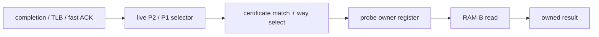
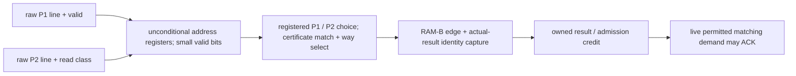

# Registered probe admission boundary — Stop 3C, 16 November 2026

**Decision: this exact overlay merits another matched seed-42 measurement fit.**
The new boundary cuts the live completion/fast-ACK selector out of certificate
matching, preserves all 256 admission-edge short reads and one-store/clock
throughput, and passes the functional gates. Maximum measured CPU regression
is 1.4435% (matrix), below the architecture review's 2% investigation threshold.
JPEG costs 1.0259–1.0515%. This is a bounded simulation cost accepted for a
physical measurement, not timing closure, production adoption or CPU admission
widening. No CI or fit was submitted in this stop.

## Source selection and scope

Base CPU is exact `9c948da8da413a882e0fe8e559c380ea0cadabf4`. The control is
**corrected Stop 3A**, not stock 9c948da8 and not the earlier buggy Step 2.
New selectable sources are in `tests/cpu/cache_probe_retime/rtl/`:

| File | SHA256 |
| --- | --- |
| cache_access.sv | 15f2e214cecaa04801425900b1ced560759496b85383f198e3c908c681257c13 |
| cache_adapter.sv | c0fd8d256523241a0cbb98472434093bb85039243cfe06126c83eaf172c9bf78 |
| cache_bank.sv | 010b7e116a5651442c2fcfc05e8a4f931c07238728ae706e0bc2c95bbf6d70b7 |
| cache_tags.sv | 0291d169a7cd4a1e9a332ed652e5c9d5428ee1ad0bf3898ff154f3a44a274c3f |
| ngage_bram.v | b8094d6f9d4b39a75ee6ba97520f663561757cf66bd9f1a2dcdeaed817b739a0 |

Only cache_adapter.sv and cache_access.sv change from corrected Stop 3A.
Bank/tags/dirty forwarding are byte-identical. Unit tests keep the qualified
mixed-port collision-poison BRAM. **CPU benchmarks use production BRAM**, in
both variants. Any later fit must select the four cache files and production
rtl/ngage_bram.v, not the simulation poison. Default cache mode and integrated
DATA_PROBE=1/LINE_REFILL=1 are both exercised; the CPU uses the real production
D-cache adapter and unchanged single-demand CPU pipeline.

Production RTL, project settings, integration branch/index, actual 78MHz PLL,
phone, previous overlays, simulations and checkpoints are untouched. No GitHub
or CI operation was made for this stop.

## Why the boundary moves

Stop 3B's routed hot 104MHz path is reset_drain → completion-next → D-TLB
match/fault → fast_hit → P2/P1 selector → certificate compare/way encoding →
probe_owner_way, slack −4.531ns. Cold starts from post-ALU o_und_ff and reaches
the same endpoint at −4.725ns. pipe_owner reaches that endpoint at −2.366ns hot.
Raw path sources are in
`build/fit/resident-store-20261116/candidate/output_files/timing/resident-store/104/`.
The old parallel prefix/OR way encoder and reset-free payload registers were
already present; repeating those rewrites would not add a register boundary.

Before, the selector changed to current P2 whenever an ordinary read was
unlaunched and not fast-hit. Otherwise it used P1. Thus a result deciding fast
ACK also decided the address and way that could be captured on that clock.



After, the adapter captures **both 27-bit line addresses unconditionally**
on every rising edge. These payload flops have no reset mux or clock-enable
condition. Two small valid/class bits capture raw P1-valid and raw ordinary
P2-read. The new scheduling selector uses only these registered values: **P1
priority, P2 fallback**. It does not use fast_hit, launched, req_ready, current
translation/fault, cache permission or response. Selecting P1 when it is present
avoids recreating the current-P2 completion dependency; an unrelated P1 can
cost an immediate P2 hit, measured below. A held demand still progresses via
the ordinary cache path even if P1 keeps naming something else.



The previous post-match owner payload register is removed. Certificate selection
now drives RAM-B's synchronous address on the next edge, while result tag/way
are captured for **that actual read**. This fuses the old owner/read scheduling
work rather than adding a full cache-read clock. The full line identity and
way checks on admitted reads remain. A hint cannot start a walk, refill,
external read/write or architectural completion.

The edge111–113 trace motivates the registered P1 priority: after A completes,
the raw P2-read flag may still describe A, while P1 already names next demand B.
Using that old P2 record merely because it is valid would displace B's private
read. P1-first retains the E112 read/E113 admission reply without consulting
A's live ACK. The alternate policy has not been benchmarked as a separate
candidate; the measured tradeoff below is for this selected policy.

Probe scheduling is independent of consumption. Adapter fast_hit still checks
current full address, read class/SWP, cache attributes, translation, alignment,
permissions, launched ownership and pending control operations. Stop 3A's
pipe_busy suppression still blocks premature returns behind stores. Immediate
reset/revoke/collision suppression stays on local valid/read publication;
payload may be overwritten privately. A raw P2 record can be speculative while
translation waits, but cannot authorize an ACK on a fault.

## Rising-edge schedule and before/after traces

All observations sample pre-NBA rising-edge ports; RAM/result checks use +1ns.
Drivers change inputs after falling edges and allow combinational settling.

| Edge | Stop 3A | Retimed 3C |
| --- | --- | --- |
| E0 | Live selected address → certificate/way → owner FF | Capture raw P1 and P2 tags/classes without enable |
| E0→E1 | Registered owner drives RAM-B | Registered hint choice → certificate/way → RAM-B |
| E1 | Read RAM-B; capture actual read's result tag/way | Read RAM-B; capture actual read's result tag/way |
| After E1 | Matching data/result token available | Matching data/result token available |
| E2 | Permitted demand consumes fast result, or owned admission reply | Same consumer convention; no new universal read clock |

For a demand admitted on E1 with a matching scheduled RAM read, both designs
capture admitted_probe_owner on E1 and sample its short response on E2.
The existing admission regression proves **256** such one-clock reads still
work, with mismatched full-line/way guards, all segments/words/masks, faults,
maintenance and reset. P1/P2 policy changes can alter which requests reach this
class; the workload measurements quantify that cost.

Real-adapter alternating-target example (A=0x1000, B=0x3000). `hint` before is
the registered post-match owner; after it is the selected registered raw hint.
ACK edges and data remain matched despite different private reads:

| Edge | Live P1 / P2 | Stop3A hint / probe read | 3C hint / probe read | Demand result, both |
| ---: | --- | --- | --- | --- |
| 111 | B / A | A / yes | B / no | A fast ACK |
| 112 | B / B | B / yes | B / yes | B accepted |
| 113 | B / B | B / no | B / no | B admission-edge ACK |
| 114 | B / A | B / yes | B / yes | A accepted |
| 115 | A / A | A / no | B / no | A still held |
| 116 | A / A | A / no | A / no | A ordinary owned ACK |

Before/after raw schedules, including delayed translation, same-slot store/load,
expired token fallback, held miss with changing P1, and all 16 stage revokes:

- `build/sim/probe-retime-schedule-control-20261116-02/run.log`.
- `build/sim/probe-retime-schedule-20261116-02/run.log`.

The evidence JSON retains compact edge samples for every phase/event/stage.
The final schedule checker independently requires exactly one sampled ACK per
held/back-to-back read. Translation publishes fault only when the wait resolves;
while undecided, no request or ACK is admitted. After a store's own completion,
an immediate read sees the committed partial bytes. After a token expires or
its certificate is revoked, ordinary fallback returns the correct word.

## Functional qualification and negative control

| Gate | Result |
| --- | --- |
| Real adapter probe test | 402 requests, 164 fast reads, 8 A/B overlap clocks, 123 blocked collisions; PASS |
| Admission-edge test | 256 short reads, three isolated identity mismatches, reset/maintenance/fault/SWP; PASS |
| Full corrected Stop3A qualification | 35 lifecycle event/stage cases with primed probes, eight fast consumers, four successful/rejected/reset/replacement cases, exact repeat; PASS |
| Actual adapter pending lock pulse | One application/done after live store, correct following read; PASS |
| Existing refill / maintenance | Dirty victim bus-error retry, indexed clean and error retention; PASS |
| New schedule | Alternating P1/P2, delayed hit/fault, held/back-to-back, same-slot freshness, expiry, 16 stage revokes; PASS on control and candidate |
| Token-identity negative | Deliberate live-P2 result tag substitution rejected against actual RAM-B slot; PASS |

In the token negative, only the result-tag capture is broken:
`probe_result_tag <= req_mva[31:5]` replaces the correct actual-read owner tag.
The independent checker reads the actual RAM-B slot and its stored tag, then
checks the published result identity after the edge. At edge **104** it rejects
an A-slot read mislabeled as live P2 B:

```text
SCHEDULE e=103 phase=0 event=0 stage=0 p1=00001000 p2=00003000 hint=0000180 read=0 slot=8 result=1 result_tag=0000180 accept=0 admit=0 fast=0 ack=0 tlb_wait=0 fault=0 reset=0
SCHEDULE e=104 phase=0 event=0 stage=0 p1=00001000 p2=00003000 hint=0000080 read=1 slot=0 result=0 result_tag=0000180 accept=0 admit=0 fast=0 ack=0 tlb_wait=0 fault=0 reset=0
[1036000] %Fatal: schedule.vh:26: Assertion failed in test: retimed result token identity mismatch against physical RAM read slot
%Error: tests/cpu/cache_probe_retime/schedule.vh:26: Verilog $stop
Aborting...
```

Raw negative: `build/sim/probe-retime-token-negative-20261116-02/`.
This failure is expected and is not part of the delivered candidate RTL.
The two isolated mismatch injections in the older admission fixture now use
force/release because the observed owner is combinational; the full-line/way
expectations and every byte/response oracle are unchanged.

## Resident-store gate

Each row has **256 ordered acceptances, physical RAM writes and sampled
responses**, in both default and integrated configurations. Every acceptance
and commit interval histogram is exactly `{1:255}`; fill latency remains **2**.
Data/slot/mask, post-write bytes, dirty halves and backing readback all pass.

| Stream | Acceptance gap | RAM-commit gap | Clean words | Second clean | Burst/drain external transfers |
| --- | ---: | ---: | ---: | ---: | ---: |
| Successive words / both halves | 1 | 1 | 8 | 0 | 0 |
| Alternating two lines | 1 | 1 | 16 | 0 | 0 |
| Same-word partial bytes | 1 | 1 | 4 | 0 | 0 |
| Lower only | 1 | 1 | 4 | 0 | 0 |
| Upper only | 1 | 1 | 4 | 0 | 0 |

Normal/repeat events match exactly; deliberate expected-byte corruption is
rejected for its intended reason. The bank/tag dirty-forwarding payloads are
unchanged from Stop3A, not replaced by an approximate expected-state model.

## Matched actual-CPU workloads

Both variants freeze exact base CPU plus explicit cache/adapter substitutions.
The full production CPU/MMU/cache path executes original guest instructions;
there is no host replacement of timed work. Identical wrapper binaries, ROM,
payloads, math/pixel/object/guard oracles, memory profiles and harness hashes
are checked between variants. Two repeats match raw windows and independent
probe counters. All six six-kernel bad-output controls and four JPEG bad-output
controls are rejected. There are **20 workload/profile groups**, seven windows
each (two warm-ups, five scored), with unchanged payload/helper instruction
checks. These are simulated fixed-work cycles, not native SPMark scores.

| Workload | I:D waits | Stop3A cycles | 3C cycles | Delta | Cycle change |
| --- | --- | ---: | ---: | ---: | ---: |
| matrix4 | 0:0 | 52,164 | 52,917 | +753 | +1.4435% |
| matrix4 | 2:9 | 52,164 | 52,917 | +753 | +1.4435% |
| transpose4 | 0:0 | 5,130 | 5,130 | +0 | +0.0000% |
| transpose4 | 2:9 | 5,130 | 5,130 | +0 | +0.0000% |
| triangle_edges | 0:0 | 25,431 | 25,332 | -99 | -0.3893% |
| triangle_edges | 2:9 | 25,431 | 25,332 | -99 | -0.3893% |
| fill16_frame | 0:0 | 71,263 | 71,263 | +0 | +0.0000% |
| fill16_frame | 2:9 | 201,306 | 201,306 | +0 | +0.0000% |
| fill16_tail | 0:0 | 2,116 | 2,117 | +1 | +0.0473% |
| fill16_tail | 2:9 | 2,116 | 2,117 | +1 | +0.0473% |
| fill8_tail | 0:0 | 2,178 | 2,178 | +0 | +0.0000% |
| fill8_tail | 2:9 | 2,178 | 2,178 | +0 | +0.0000% |
| diffuse_m10_8x8_jpeg | 0:0 | 86,720 | 87,618 | +898 | +1.0355% |
| diffuse_m10_8x8_jpeg | 2:9 | 86,720 | 87,618 | +898 | +1.0355% |
| diffuse_m10_8x8_random | 0:0 | 86,736 | 87,634 | +898 | +1.0353% |
| diffuse_m10_8x8_random | 2:9 | 86,736 | 87,634 | +898 | +1.0353% |
| diffuse_m8_8x8_random | 0:0 | 85,590 | 86,490 | +900 | +1.0515% |
| diffuse_m8_8x8_random | 2:9 | 85,590 | 86,490 | +900 | +1.0515% |
| diffuse_m10_16x8_jpeg | 0:0 | 170,976 | 172,730 | +1,754 | +1.0259% |
| diffuse_m10_16x8_jpeg | 2:9 | 170,976 | 172,730 | +1,754 | +1.0259% |

With Stop3A=100, equal-weight throughput index is **99.81843** for the six
kernels and **98.97358** for JPEG, identical in both delay profiles. No group
exceeds the 2% regression threshold. No latency-changing revision was needed
after this measured candidate; a naive extra owner stage was avoided by the
fused match/RAM schedule.

### Where the cost appears

Counters below describe scored **window 3**, pre-NBA interface events. Fast
counts are sampled adapter fast-hit opportunities, admitted counts are owned
admission credits, and fallback counts are read acceptances without such a
credit (not synonymous with external misses). Data-wait clocks are CPU stall
occupancy; they are not additive predictions of total cycle change.

| Workload | Fast edges delta | Admitted delta | Fallback delta | Data-wait delta | Total cycles delta |
| --- | ---: | ---: | ---: | ---: | ---: |
| matrix4 | -361 | +32 | +329 | +868 | +753 |
| transpose4 | +0 | +0 | +0 | +0 | +0 |
| triangle_edges | -66 | +51 | +15 | -101 | -99 |
| fill16_frame | +0 | +0 | +0 | +0 | +0 |
| fill16_tail | -1 | +1 | +0 | +1 | +1 |
| fill8_tail | -1 | +1 | +0 | +1 | +0 |
| diffuse_m10_8x8_jpeg | -822 | +749 | +73 | +1026 | +898 |
| diffuse_m10_8x8_random | -822 | +749 | +73 | +1026 | +898 |
| diffuse_m8_8x8_random | -821 | +748 | +73 | +1025 | +900 |
| diffuse_m10_16x8_jpeg | -1614 | +1477 | +137 | +2010 | +1754 |

Matrix loses 361 immediate fast edges and takes 329 more fallback read
acceptances, with 868 more data-wait clocks and net +753 cycles. This is the
measured cost of using registered P1-first scheduling rather than a same-cycle
P2/fast-ACK-driven choice. Triangle's read timing/overlap changes in the other
direction: 101 fewer data-wait clocks and 99 fewer total clocks despite fewer
immediate fast edges; a count of ACK classes alone is not a latency model.
Transpose is unchanged. Full-frame fill remains dominated by its existing
write/drain behavior and is identical in both profiles. The 16-bit tail changes
one fast edge into an admitted read, costing one clock; the corresponding
8-bit tail adds one wait clock hidden by other work and total cycles stay equal.

For 8×8 JPEG mode10, 822 fast edges become 749 additional admission credits and
73 additional fallbacks. Cache wait-state deltas are LOOKUP_CAPTURE +821,
LOOKUP +66, LOOKUP_WAIT +66, READ_LINE +73, IDLE +2, STORE_HIT/COMMIT −1 each:
these reconcile to +1,026 wait clocks but only +898 elapsed clocks because
other pipeline work overlaps. Mode8 has analogous +1,025 wait/+900 elapsed.
The 16×8 case has +2,010 waits/+1,754 elapsed. Both profiles match because these
warm converters have no relevant external-delay change. This retains admission
read benefit rather than erasing it; it pays for a subset of lost immediate
returns. The fall in repeated private RAM reads is also recorded, but is not
claimed as measured power savings or CPU work removed.

## Structural audit and remaining physical gates

| Side of new boundary | Combinational work |
| --- | --- |
| Before adapter tag FFs | Raw P1 and raw P2 addresses independently; no selector, permission, fast-ACK, launched/ready or clock-enable dependence on these payload D inputs |
| Valid/class capture | Only raw P1-valid and raw ordinary P2 read class, with reset on two small valid bits |
| After boundary | Registered P1/P2 priority → eight certificate matches/prefix selection → six-bit way → synchronous RAM-B address |
| Consumer side | Actual-read result token → full-line identity/current permission/class → fast ACK or owned admission response |

The former probe_owner_way register endpoint is gone. That does not prove the
new RAM-B address/enable or result-owner endpoints meet timing. The remaining
plausible longest local cone is registered hint/certificate → match/way select
→ RAM-B address/port arbitration; reset/revoke/collision still suppress result
publication locally. No exception, multicycle waiver or clock change is added.

Separately unchanged: Stop3B's **certificate→store owner −1.168ns hot104** and
**reset_drain→store payload −2.283ns hot104**. They are distinct from the new
probe schedule and remain open physical work. Dirty forwarding's prior margin
is retained structurally, not remeasured. There is **no new routed slack** in
this stop. The next fit must also recheck all those paths, reset recovery,
HDMI, packing and the known incomplete external SDRAM constraints.

Raw state count increases about **22 FFs** versus Stop3A: two 27-bit addresses
plus two valid bits replace the 33-bit post-match owner and its valid. Estimate
roughly +10–40 ALMs, no added RAM/DSP, before synthesis/packing. Relative to the
initial control that is about 124 extra state bits before pruning/retiming,
not a promised fitted register delta. The exact overlay merits a measurement
fit because it establishes the intended boundary at <2% measured workload
cost, not because the remaining timing failures are solved.

## Replay and evidence

Run from the existing integration checkout, using new names/paths. All Docker
calls use the installed jotego/simulator:arm64 image, --pull=never --network none.

```sh
# Original Stop3A schedule, then new schedule; --old means corrected Stop3A.
python3 tests/cpu/cache_probe_retime/run.py build/sim/retime-before --fixture schedule --old
python3 tests/cpu/cache_probe_retime/run.py build/sim/retime-after --fixture schedule
# Expected failure, a test-only result-token identity defect:
python3 tests/cpu/cache_probe_retime/run.py build/sim/retime-negative --fixture schedule --negative
# Functional suite and existing adapter/cache gates:
python3 tests/cpu/cache_probe_retime/run.py build/sim/retime-qualification
python3 tests/cpu/cache_probe_retime/run.py build/sim/retime-probe --fixture cache_probe
python3 tests/cpu/cache_probe_retime/run.py build/sim/retime-admit --fixture cache_admit_probe
python3 tests/cpu/cache_probe_retime/run.py build/sim/retime-lock --fixture adapter_lock
python3 tests/cpu/cache_probe_retime/run.py build/sim/retime-refill --fixture cache_refill
python3 tests/cpu/cache_probe_retime/run.py build/sim/retime-maint --fixture cache_maintenance
python3 tests/cpu/cache_probe_retime/stream.py build/sim/retime-stream-default
python3 tests/cpu/cache_probe_retime/stream.py build/sim/retime-stream-integrated --data-probe 1 --line-refill 1
# Full original CPU workloads: both profiles, two repeats, bad-output checks.
python3 tests/cpu/cache_probe_retime/bench.py --kind six --variant control --name retime-before
python3 tests/cpu/cache_probe_retime/bench.py --kind six --variant candidate --name retime-after
python3 tests/cpu/cache_probe_retime/bench.py --kind jpeg --variant control --name retime-before
python3 tests/cpu/cache_probe_retime/bench.py --kind jpeg --variant candidate --name retime-after
```

Qualified raw CPU runs:
`build/sim/{spmark-payload,jpeg-payload}/probe-retime-{control,candidate}-20261116/`.
Each contains source snapshots, executable/input/harness hashes, exact guest
images, oracle results and raw metrics. The independent math/pixel code remains
unchanged. Reusable JPEG workload/profile helpers previously under scratch
were promoted into the test directory before relying on them. Host extraction
inputs remain the same qualified original files used by the existing runner.

Qualified unit paths and their exact manifests/log hashes are listed in
`docs/evidence/cache-probe-admission-retime-20261116.json`, together with source
hashes, all cycle/metric deltas and before/after stage traces. The final schedule
runs are `probe-retime-schedule{-control}-20261116-02`; earlier -01 traces are
superseded only by stronger ACK accounting and delayed fault publication in
the fixture. No candidate RTL failure was fixed by weakening an oracle.

Stop here. Another seed-42 fit is a recommendation, not a submission. Keep
production adoption, CPU admission widening, phone work and DDR3 work separate.
