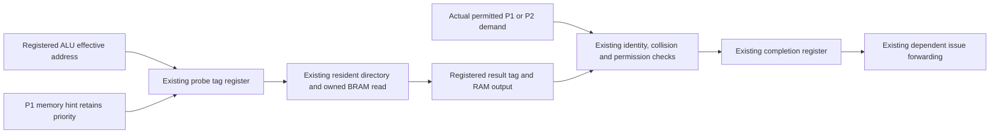

# Step 5K — earlier registered resident-line lookup

**Keep the combined offline prototype: it now advances real span consumers
and improves both original span patterns by about 4%.** The existing P1
load-start mechanism's favorable one-instruction-per-clock stream is preserved.
Production remains exact 5F; no hardware, fit or production adoption was done.

| Same checked work, both wait profiles | Exact 5F | Previous P1 prototype | Earlier-lookup prototype |
| --- | ---: | ---: | ---: |
| Original forward span, 512 pixels | 38,063 | 38,063 | **36,528** |
| Original reverse span, 512 pixels | 37,988 | 37,988 | **36,453** |
| Original transpose, added guards | 3,443 | 3,441 | **3,441** |
| Independent load/ALU, one resident line | 598 | 343 | **343** |
| Dependent 32-load/add checksum | 303 | 303 | **271** |
| Independent load/ALU, eight resident lines | 627 | 619 | **499** |

Forward is **74.341796875→71.34375 cycles/pixel**, a **4.0328%** reduction.
Reverse is **74.1953125→71.197265625**, a **4.0407%** reduction. The saved
**1,535 clocks** per span window are elapsed-cycle savings including final-store
completion. The eight-line kernel improves **19.3861%** versus P1, and the
dependent checksum improves **10.5611%**. These are fixed-work CPU/cache
simulations, not game FPS or physical SDRAM measurements.

## One new mechanism on the retained P1 path

[Step 5J](cpu-load-pipeline.md) moved eligible actual load demands from P2 to
P1 and reached one useful start per clock for independent loads sharing one
resident line. The span stayed unchanged: its registered effective address
existed at dequeue+3, but the private hint did not reach the BRAM read port
until +5. An earlier demand alone left ACK at +6 and its consumer at +7.

The new overlay changes only `zap_core.sv`, starting from the maintained 5J
overlay. An eligible load's **existing registered ALU effective address** may
drive the existing private probe interface one clock before P1. The adapter
still captures the tag into its existing register before directory selection
and synchronous BRAM read. There is no dequeue-time address adder or live
tag/BRAM bypass into issue.

A current P1 memory operation keeps priority. The new hint requires an original
unconditional, aligned ARM immediate word LDR, no writeback/PC/SWP, valid
registered ALU load state, and no exception, data stall, ALU clear, writeback
clear or reset. When these conditions fail, the original P1 hint remains.
This retains the adjacent-load pair path and older store/hint ownership. The
actual request still uses 5J's qualified P1→P2 handoff, current mapping,
permissions, alignment, cacheability and the existing completion slot.

The private hint has no TLB request or external bus authority. Missing
certificates fall back normally. An internal read can prepare a result, but
the eventual actual demand must independently pass current permission and
match its full line identity. Same-slot commits block reads and invalidate
conflicting results through the existing collision guards. Reset, maintenance,
directory revocation and mapping/context rules are unchanged. No speculative
walk, refill, device read, write or architectural completion is introduced.

## Actual dependent-load schedule

The table follows a typical destination-bias stack load in the original span.
Source-base and loop-bound loads show the same schedule. All times are observed
rising-edge sample offsets from that instruction's actual dequeue.

| Event | Exact 5F | P1 alone | P1 plus earlier lookup |
| --- | ---: | ---: | ---: |
| Resolved operands / actual dequeue | 0 | 0 | 0 |
| Registered issue / shifter packets | 1 / 2 | 1 / 2 | 1 / 2 |
| Registered ALU effective address | 3 | 3 | 3 |
| Earlier private ALU hint offered | — | — | **3** |
| Actual demand first offered and permitted | 5 | 4 | 4 |
| Probe tag available / physical BRAM read | 5 / 5 | indexed read at 5 | **4 / 4** |
| Owned aligned word and ACK | 6 | 6 | **5** |
| Registered completion / useful consumer issue | 7 / 7 | 7 / 7 | **6 / 6** |

The new result is a genuinely earlier synchronous read and response, followed
by the existing registered completion. Live ACK does not release issue.
Address, translation and operand dependence still have their normal boundaries.

The first scored 0:0 journal records **all 512 occurrences** of each targeted
load/consumer pair in both original patterns. Every one advances by exactly
one clock relative to both controls. Source-base and loop-bound distances are
**512×7→512×6**. Destination-bias distances are **510×7 plus 2×8 → 510×6 plus
2×7**; the extra arrival clocks in those two cases remain. This is **1,536
actual earlier consumer starts per pattern**, not an estimate from a short trace.
All timing windows and both full repetitions also match at 2:9.

Four eligible ALU hints occur per pixel, **2,048 per span window**. The adjacent
stride/source-bias word pair also prepares its first result earlier, but MLA
still waits for the second load. That hint is not credited as another useful
consumer gain. The store-following coordinate-step load retains the older-store
ordering path. The two byte loads keep their original instruction class,
formatting and owned response rules.

Representative forward iterations retain the line-crossing costs while moving
the three useful dependencies:

| Iteration situation | Previous P1 | Earlier lookup |
| --- | ---: | ---: |
| Typical resident iteration, pixel 7 | 73 | **70** |
| Source-line relookup, pixel 8 | 78 | **75** |
| Destination-line crossing, pixel 13 | 76 | **73** |

## Nonoverlapping gain accounting and last store

The span uses the same exclusive stall accounting as 5I/5J. A lock coincident
with a data stall belongs only to the data-stall bucket.

| Forward scored window | Previous P1 | Earlier lookup | Delta |
| --- | ---: | ---: | ---: |
| Read data stall | 8,160 | 6,624 | **−1,536** |
| Write data stall | 3,267 | 3,267 | 0 |
| Load dependency without data stall | 12,794 | 12,794 | 0 |
| Other dependency without data stall | 3,584 | 3,584 | 0 |
| Empty operand queue | 18 | 19 | +1 |
| Other / advancing | 10,240 | 10,240 | 0 |
| **Elapsed cycles** | **38,063** | **36,528** | **−1,535** |

Reverse has the same deltas, with read stalls **8,085→6,549**. The first
back-edge issue moves **81→78**, but the next iteration starts **87→85**:
one additional empty delivery clock absorbs one of the three local gains.
Subsequent typical iterations gain three clocks. The load dependency count
does not shrink because the removed overlapping wait was classified as a
read data stall. Neither bucket is counted twice.

Timing retains the original first-dequeue→final-original-back-edge retirement
boundary. Forward's last actual cache RAM write is at **36,507**, its store
retires at **36,509**, and the window ends at **36,528**. Reverse is
**36,432 / 36,434 / 36,453**. All 512 accepted halfword stores, RAM mutations
and store retirements complete in order; pending stores and the write buffer
are empty at the end. Cache-visible completion is included; dirty writeback
afterward is outside the score. The existing killed next-iteration prefix is
still **one extra dequeue, not retired guest work**.

## Throughput is preserved and extends beyond one line

The original single-line stream remains **343 cycles**, retaining the same
256 unique architectural starts and 256 matching retirements. Its fixed steady
region has **224 starts in 224 clocks**, all successive gaps one clock.
All 128 fault-free owned load values match their expected selected words.
Private probes and STM/LDM micro-ops remain excluded from these start counts.

The new multi-line stream has the same load/independent-ALU mix, register
preservation and 256-instruction region. It selects offsets **0,32,...,224**
from eight resident 32-byte lines rather than eight words of one line. Every
load result is independently checked against its PC's source offset. Exact
5F takes **627**, P1 **619**, and the combined candidate **499 cycles**.

For the fixed 224-start interior, P1 takes **452 clocks**, the new path **342**.
There are 111 one-clock gaps in both; 110 three-clock gaps become two-clock
gaps, while two five-clock gaps remain. Typical load initiation interval is
therefore **4→3 clocks** for this alternating mix. The measured start rate is
**0.496→0.655 instructions/clock**, not one instruction per clock across
arbitrary lines. Certificate acquisition and the single read-port service
contract still constrain the broader case.

The multi-line trace is explicitly window 2, its last declared warm-up; its
complete window cycle/traffic metrics equal the first of the five scored
windows, including zero external transfers. It is representative trace evidence,
not relabeled as a scored window. The single-line and span journals are their
first scored windows. The separate dependent stream's refill-bearing warm-ups
remain excluded from its **303→271** scored result.

## Qualification and source/timing budget

Fresh exact 5F, previous P1 and combined-candidate runs use identical guest
program hashes, synthetic inputs, original images, output oracles and testbench
fixtures. Each of six cases runs both 0:0 and 2:9, five scored samples and
two equal repetitions. All scored external reads, writes and line requests
are zero. Both original span patterns still execute **10,240 retired original
instructions** per window; transpose executes 800 original payload instructions.
All original dynamic retirement PC streams match between the three variants.

Whole destination arenas/guards, original mathematical and Unicorn references,
source/stack integrity and actual cache RAM mutations/byte enables pass. Per
window these are **512 halfword mutations / 1,024 bytes** for a span,
**384 word mutations / 1,536 bytes** for guarded transpose, **7 / 28** for
each independent stream including its saved-register stores, and **1 / 4**
for the dependent checksum. Every mutation count equals acknowledged stores.
All **36 final wrong-output runs** are rejected.

All three CPUs pass the extended real-CPU safety guest twice at both profiles:
cold waited load, IRQ entry/return, exact abort FAR/FSR, unchanged fault and
younger destination sentinels, excluded fault-path/flushed device reads, and
fresh loads after same-line stores with and without intervening ALU work.

The actual unchanged 5F adapter/cache also passes two equal collision-poison
pressure runs: younger read on an older reply, permission fault, waiting
translation, changed address, intervening alias store, reset, competing P1/P2
probes, full three-credit pressure, simultaneous allocate/return and a following
fault. Peak pending credits=3, full holds=4, simultaneous event=1, active-probed
load wait clocks=7. These stress the existing guards on which the earlier hint
relies. The candidate passes eight focused ARM/Thumb, MMU/FCSE, actual/discarded
prefetch-fault and return-alias CPU diagnostics as well. No output failure was
waived and no second RTL mechanism was tried.

Only one maintained RTL file differs from either control: the isolated core
overlay. All **60 frozen RTL/header inputs** are recorded; Verilator actually
reads **51**. Production source hashes remain exact `8e70b1e`. Cache capacity,
associativity, directory entries and one synchronous read-B/write-A port pair
are unchanged. The previous P1 completion/owner controls are retained.

Incremental structural cost over P1: **zero added flops, payload buffers,
RAMs/ports, DSPs, address adders or forwarding sources**. The new choice adds a
two-input mux for the **27 useful line-tag bits** into the existing tag register,
two two-bit checks and registered-valid/exception qualification. A source-level
planning allowance of roughly **16–24 additional ALMs** for mux/control is
unverified; it is not a mapped-area result. The adapter tag register remains
an explicit timing boundary before the existing directory compare and BRAM
address path.

The new timing path is registered ALU address/flags and P1 memory-valid state
through hint selection into the existing private tag register. Its data-stall
input derives from registered P2/completion ownership, not live ACK. No live
cache/translation result selects the hint payload or releases issue. The
physical PLL remains **78 MHz**, design target **104 MHz (9.615 ns)**; no
Quartus or routed timing was run. Control fanout and the extra mux need an
actual timing check before any production adoption.

## Decision and replay

This is worth retaining: it turns the previous throughput foundation into a
repeatable real-kernel gain, advances all three targeted span dependencies,
and improves an eight-line workload while preserving the favorable one-clock
instruction initiation interval. Keep the combined prototype for broader CPU
workload qualification and eventual timing assessment. Production stays 5F;
there is no hardware or phone correctness claim and no FPS extrapolation.

[Reusable tests and commands](../tests/cpu/cpu_load_lookup/README.md) ·
[Audited machine results and schedules](evidence/cpu-load-lookup-20261117.json) ·
[Complete bounded journals](evidence/cpu-load-lookup-20261117.events.json.gz).

Final runs under `build/sim/cpu-load-lookup/` are `step5k-5f-01`, `step5k-p1-01`
and `step5k-lookup-02`; the latter reuses the hash-verified unchanged executable
from the initial five-case `step5k-lookup-01`. Guard tests and focused diagnostics
are `step5k-pressure-01` and `step5k-diagnostics-01`. The analyzer preserves and
checks the reused executable's actual source/include manifest as well.

Only this experiment's completed generated compiler trees, frozen source copies
and derived binary/hex inputs were retired after verification. Compressed logs,
synthetic assembly, manifests, oracles, negatives and compiler-input hashes
remain. Private original code and disassembly stay out of Git. Other chats'
files/runs, production RTL, historical fit tags and the master branch were
preserved. No donor work, hardware access, CI, Quartus, new branch or worktree.
