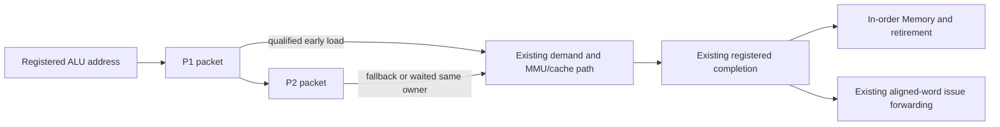

# Step 5J — pipelined ordinary-load start

Follow-up: [Step 5K](cpu-load-lookup.md) retains this P1 mechanism and advances
its private lookup from the registered ALU address. It measures typical span
load-use **7→6** and about **4%** real-kernel savings while preserving this
experiment's one-clock favorable initiation interval. The 5J measurements below
remain its unchanged comparison point.

**One isolated prototype sustains one architectural instruction start per
clock in a favorable resident stream, but does not shorten the span's seven-clock
dependent load-use distance. Keep production at exact 5F.** The complete
independent stream falls **598→343 cycles**. Its fixed steady region has
**224 ordered starts in 448→224 clocks**, with matching retirements and checked
load values. Both original 512-pixel patterns stay **38,063 / 37,988 cycles**.
Original-layout transpose improves **3,591→3,560**; with added destination
guards its matched comparison is **3,443→3,441**. Wrapper layout and warm-state
sensitivity are material; the larger transpose difference is not universal.

The mechanism is **P1 load ownership before P2 memory ownership**, using the
existing registered effective address and completion slot. This is a measured
throughput result, not a general pipelined-cache bandwidth or game-FPS claim.

## Why the span load waits five clocks to demand

The investigation read the [load forwarding](cpu-load-forwarding.md),
[waiting-load delivery](cpu-load-delivery.md) and [independent pair overlap](cpu-load-overlap.md)
reports first. Those already provide registered aligned-word completion
forwarding, issue on actual formatted load commit, a private waiting-P2 probe,
and certified younger-word BRAM reads on an older adjacent load's reply edge.
This prototype does not repeat those changes or bypass live ACK into issue.

Take pixel 7's destination-bias load in the saved span trace. At dequeue,
all its register operands are resolved; SP is stable and the offset is known.
No older data stall delays this instruction's first five edges. The same is
true for the source-base and loop-bound loads in this representative iteration.

| Edge from actual dequeue | Exact 5F owner/work | P1 prototype owner/work |
| ---: | --- | --- |
| 0 | Accepted original instruction; resolved base/offset | Same |
| 1 | Registered issue operands enter shifter | Same |
| 2 | Registered shifter result enters ALU | Same |
| 3 | Effective address in ALU register | Same |
| 4 | P1 owns registered address; private probe tag captures | P1 offers actual qualified request; mapping/permission already valid |
| 5 | P2 offers demand; permitted resident probe reads BRAM | Same packet is now P2; indexed read reads BRAM |
| 6 | BRAM word / ACK | BRAM word / ACK |
| 7 | Registered completion; dependent add can issue | Same |
| 8 | Load retirement | Same |

The names can mislead: `postalu0` is an alias of the ALU output here, not
another pipeline register. The five-clock dequeue→demand distance consists of
issue, shifter, ALU, P1 and P2 registered ownership boundaries. It is not five
clocks of external memory service. The first observed translation/permission
qualification for the **actual demand** is at 5 in 5F and 4 in the prototype;
the underlying mapping tokens can already exist. A private cache read never
authorizes an architectural access by itself.

The owned raw result at edge 7 is already aligned and full width. The existing
completion-forwarding path releases its dependent consumer on that edge.
There is no extra load-commit clock left to remove at issue. The source-base
load followed by its address add and the loop-bound load followed by compare
both show the same **7→7** distance. Their effective addresses are ready at
3, their BRAM read remains at 5, and their response remains at 6. Narrow source
byte loads and all store paths retain their existing formatting and protocol.

The prototype starts **2,048** span loads from P1 per window, four per pixel.
Actual acknowledged loads remain **4,096**, and useful work does not move.
It adds one offered/waited edge per early request and reduces private probe
counts. Neither counter is an architectural instruction or a cycle saving.

## One exercised prototype and its ownership contract

Only the isolated `tests/cpu/cpu_load_pipeline/rtl/arm/zap_core.sv` differs
from accepted `8e70b1e`. All other 59 frozen RTL/header inputs are identical;
the actual Verilator read set has 51 RTL/header files. Production sources,
patches, PLL and cache geometry remain unchanged.

The eligible original class is the existing registered unconditional ARM
immediate word LDR, pre-indexed without writeback or PC base/destination.
P1's selected address must be aligned, valid, non-SWP, ordinary, non-Thumb
and free of exception/force-user state. Older P2 must have no memory request,
SWP, exception or possible PC effect. Older Memory exception/PC effects and
writeback kill exclude the start. All other classes keep their 5F path.

When the slot is empty and older P2 is safe, P1 may offer its actual request.
That edge advances P1 to P2 independently of ACK because older P2 has no
blocking memory request. If ACK arrives, the existing completion register
and the P2 packet capture the same instruction on the same edge. If it does
not, P2 holds the identical address, direction, width, privilege and destination
until response; global backpressure then works as before. No second queue,
copied response, speculative request or replay credit is introduced.

P1 address selection includes privilege, alignment, data direction/byte enables,
translation override, register index and load format together. The normal
completion-next handoff remains unchanged when an older P2 completion exists.
Fault/retry responses remain attached to their P2 owner, and younger requests
cannot consume those responses. Older stores still drain through the existing
adapter guard before any read can complete. The existing current-demand MMU,
permission, cacheability and alignment checks still authorize every request;
noncacheable loads use the ordinary serialized bus path. Existing younger
private probes retain their collision, full-line identity and revoke checks.
They cannot initiate an external walk, refill or device read.

## Independent work: initiation interval and retirement

The synthetic stream performs 128 aligned loads from eight words in one
resident cache line, alternating with 128 independent ALU increments. The
source base does not change and each load's destination is unrelated to the
intervening ALU operation. This is deliberately favorable full-line reuse,
not random-address or cache-miss throughput. Prologue/epilogue, macro-uops,
wrapper calls and final publication are outside the selected 256-instruction
architectural region.

The following schedule follows the same dynamic load at payload offset 0x88.
Offsets are relative to its own actual dequeue in each variant:

| Event for that load | 5F stream | P1 stream |
| --- | ---: | ---: |
| Instruction dequeued | 0 | 0 |
| Effective address registered | 5 | 3 |
| P1 packet | 8 | 4 |
| Demand / ACK | 9 / 10 | 4 / 4 |
| Registered completion | 11 | 5 |
| Architectural retirement | 12 | 6 |

The 5F load's extra **four** dequeue→demand clocks are holds behind earlier
**independent** loads, not additional intrinsic address-generation stages.
Two of those holds precede its registered ALU address and two occur before
P1 can advance. This distinguishes the stream from the unheld span load above.

In steady candidate flow the old RAM line has already been privately read and
remains valid for the next actual word selection. Each newly offered P1 load
independently passes its permissions and consumes a matching registered result.
The next edge has its completion in P2 while an independent ALU instruction
advances. The following load can use the empty completion slot immediately
after that ALU, instead of waiting until it reaches P2.

| Relative edge | New architectural start | Registered ALU work | Actual request/response | Retirement |
| ---: | --- | --- | --- | --- |
| 0 | Load L0 | Earlier independent ALU | Earlier load L−2 ACK | Earlier instruction |
| 1 | Independent ALU A0 | Address of L−1 | L−2 completion | Earlier instruction |
| 2 | Load L1 | Earlier ALU A−1 | L−1 P1 demand + ACK | Earlier instruction |
| 3 | Independent ALU A1 | Address of L0 | L−1 completion; private resident-line read | Earlier instruction |
| 4 | Load L2 | ALU A0 | L0 P1 demand + ACK | Earlier instruction |
| 5 | Independent ALU A2 | Address of L1 | L0 completion; private resident-line read | Earlier instruction |
| 6 | Load L3 | ALU A1 | L1 P1 demand + ACK | L0 |
| 7 | Independent ALU A3 | Address of L2 | L1 completion; private resident-line read | A0 |
| 8 | Load L4 | ALU A2 | L2 P1 demand + ACK | L1 |

The fixed steady region excludes the first and last 16 instructions. 5F starts
224 instructions in **448 clocks**, with alternating 3/1-clock start gaps.
The candidate starts the same 224 in **224 clocks**, with all 223 successive
gaps exactly one. Thus instruction initiation interval is **2→1 clocks**, and
load initiation interval in this 50% load mix is **4→2 clocks**. It is not a
claim of two instructions per clock or one dependent load per clock.
The matching 224 retirements span 446 clocks in 5F (the opposite 1/3 gap phase)
and 224 in the candidate, whose retirement gaps are all exactly one.

All 256 region starts have unique ordered PCs matching all 256 retirements.
All 128 owned, fault-free completion values match the initialized word selected
by that exact load PC. The whole region takes **518→267** clocks from first
to last start inclusive; the complete checked kernel window takes **598→343**.
Those end-to-end improvements prevent crediting a stall merely moved beyond
the selected steady interval. The stream's 261 original payload instructions
include its saved-register prologue/epilogue and final publication/return;
their internal STM/LDM micro-ops do not inflate architectural throughput.

## Matched fixed-work measurements

Both 0:0 and 2:9 synthetic instruction/data wait profiles give every result
below. Each variant has five checked scored samples and two exact repeats.
Every scored sample has zero external reads, writes or line refills. Span,
transpose and independent stream use two warm-ups; the small dependent stream
uses three because its third window still refills instruction code.

| Same checked work | Exact 5F | P1 prototype | Change |
| --- | ---: | ---: | ---: |
| Span forward, 512 pixels | 38,063; 74.341796875/pixel | Same | 0 |
| Span reverse, 512 pixels | 37,988; 74.1953125/pixel | Same | 0 |
| Original transpose, original wrapper layout | 3,591 | 3,560 | −31, −0.863% |
| Original transpose, added guard layout | 3,443 | 3,441 | −2, −0.058% |
| Independent load/ALU stream | 598 | 343 | −255, −42.642% |
| Dependent load/add checksum stream | 303 | 303 | 0 |

The guard layout adds 32 nonuniform bytes on each side of transpose's 2,048-byte
buffer and checks both. It changes wrapper addresses, setup/checker instruction
placement and warm state, while executing identical original transpose code
on identical matrix inputs. Its different baseline must not be credited to
the CPU. Both layouts are retained as a sensitivity result. In the original
layout, inter-call start gaps move 112→111 in 29 cases, 119→118 once and
115→114 once; the two-clock guarded gain shows that most original-layout
exposure disappears under a different wrapper schedule.

The full-window observer independently counts actual accepted stores, physical
cache RAM mutations and enabled bytes: **512 / 512 / 1,024** per span,
**384 / 384 / 1,536** per guarded transpose, **7 / 7 / 28** for the independent
stream including its saved-register stores, and **1 / 1 / 4** for the dependent
checksum. Counts, original retirement streams, source/stack checks and all
outputs/guards match. Span's last actual cache store still precedes the final
original branch retirement by 22 clocks. One killed next-iteration dequeue
remains separate from its 10,240 retired original instructions.

## Safety, cost and next decision

Both final executables pass real CPU cold-load backpressure, dependent result,
IRQ entry/return, section translation fault with exact FAR/FSR, unchanged fault
destination and younger destination sentinel, and exclusion of younger fault-path
and flushed MMIO loads. Any such external device read fails the harness.
These run twice at both wait profiles. The existing D-cache assertions check
complete held translation context and destination/format identity; the new
observer additionally checks demand PC/address continuity across P1→P2 and
every wait. Existing cache/store collision and ownership assertions stay active.

The byte-identical candidate CPU also passes eight focused real CPU diagnostics:
ARM/Thumb smoke, MMU/FCSE, actual/discarded prefetch faults and the trained
return-alias guard at both test latencies. Twenty wrong-output runs across the
two final variants are rejected. Independent original-byte Unicorn/reference
checks and all repeated windows pass. This is targeted offline qualification,
not a replacement for a future full CPU integration campaign or hardware test.

Structural budget: **zero added flops, payload storage, RAM blocks/ports,
cache entries, DSPs, address adders or pipeline registers**. The prototype adds
four six-bit register-index comparisons, three two-bit checks, valid/exception
qualification and an OR into the existing P1/P2 mux control. Plan roughly
**32 ALMs for added control before routing replication**, an unverified source
estimate rather than a synthesis result. The existing request payload muxes
retain their two inputs. No register-file port or new result-forwarding source
is added.

The timing risk is explicit: P1/P2 registered packet flags now feed a wider
owner-select predicate, which drives the existing address/context mux and
MMU/cache response-to-completion path. There is no combinational ACK→global
stall/issue release and no new multiplier or tag-RAM→issue path. The response
still crosses the completion register. The physical PLL stays **78 MHz** and
the design target **104 MHz (9.615 ns)**. No fit or routed timing was run, so
104 MHz closure and mapped ALMs remain unmeasured. Adoption would require that
path check, especially control fanout, rather than adding an unsafe live hit
or ACK bypass.

**Keep this prototype as a bounded throughput result; keep production 5F.**
It demonstrates that the existing registered stages and one completion slot
can sustain one useful start/retirement per clock in the favorable line-reuse
case. The first dependent span loads still hit the actual blocking edge:
the BRAM read remains at dequeue+5. Earlier request ownership alone does not
advance their consumers.

The smallest next interface step for those loads is an **earlier registered
lookup lane from the already registered ALU address**, with a retained owner
through BRAM read and response. It must prepare the permitted resident line
before the current P1 probe-capture edge, retain/kill its result under stalls,
and consume it only after the actual request's current translation/permission
and store-collision checks. Missing certificates and noncacheable addresses
must fall back without speculative walks, refills or device effects. Reusing
the existing B port requires explicit read/reply arbitration, including adjacent
loads and store commits; a new BRAM port cannot be assumed. A dequeue-time
registered address generator could move address availability further, but would
need the same owned response and capacity contract and would add a 32-bit adder
path from resolved operands. Neither deeper mechanism was implemented in 5J.

## Reproduction and retained evidence

[Reusable test and commands](../tests/cpu/cpu_load_pipeline/README.md) ·
[Audited results, source hashes and schedules](evidence/cpu-load-pipeline-20261117.json) ·
[Complete bounded edge/issue/retirement journals](evidence/cpu-load-pipeline-20261117.events.json.gz).

Final matched runs: `build/sim/cpu-load-pipeline/step5j-{control-04,candidate-02}/`.
Earlier original-layout receipts: `step5j-{control-03,candidate-01}/`.
Focused diagnostics: `step5j-diagnostics-01/`. The analyzer rechecks source,
program, fixture, compiler-input and executable hashes before publishing evidence.

Fixture corrections: the first synthetic stream omitted callee-saved register
preservation and failed its independent oracle before execution. The small
dependent stream needed three declared warm-ups; its external refill window
was excluded, not scored. The first IRQ guest consumed the trigger with its
setup store while IRQs were masked; the final guest uses a separately checked
cold load and triggers on the later initialized-word read. No CPU-output
failure was waived and no second RTL mechanism was tried.

Only this investigation's completed generated compiler trees, frozen source
copies and binary/hex inputs were retired after verification. Compressed logs,
synthetic assembly, manifests, oracle/negative receipts and compiler input hashes
remain. Original app/code/disassembly stay private and out of Git. Other chats'
files and runs were preserved. No donor work, hardware, CI, Quartus, branch or
worktree was used.
