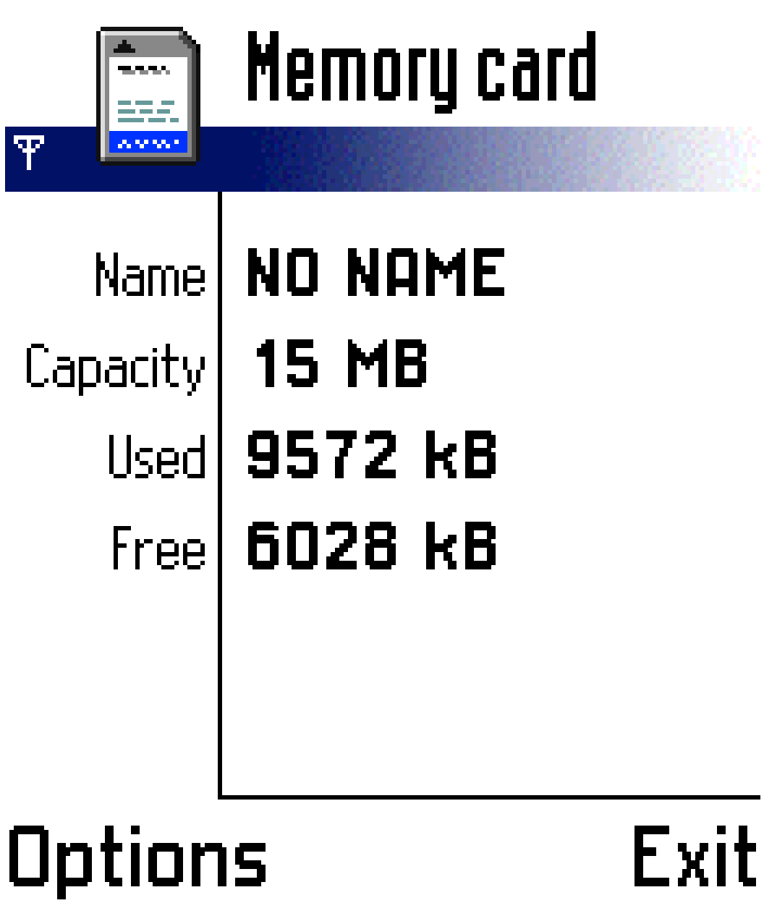
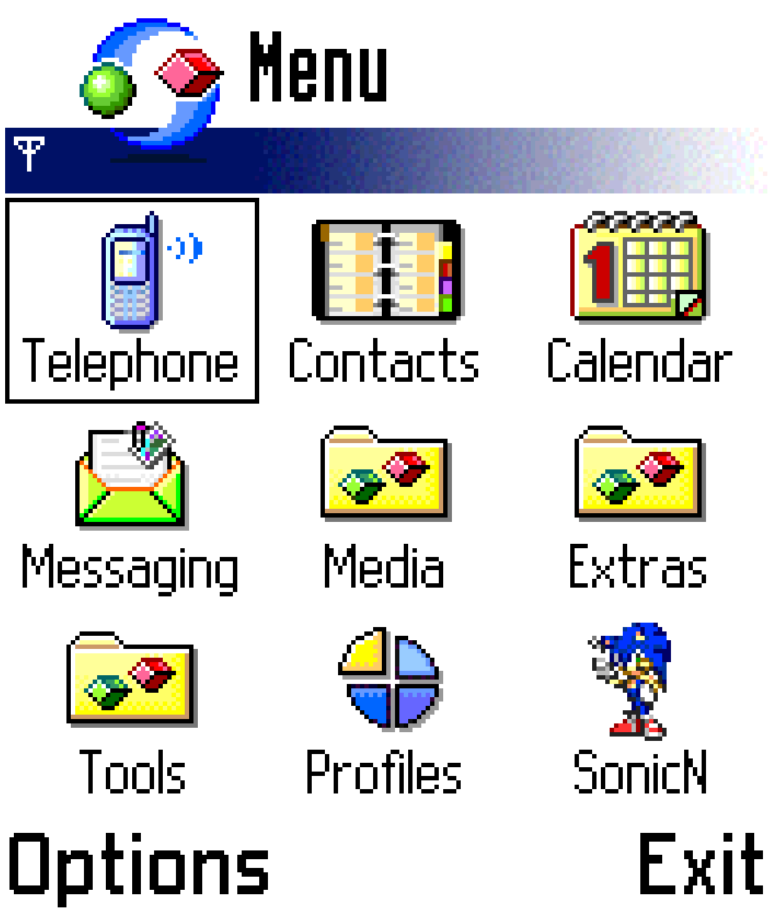

# MMC insertion and application discovery

## Hardware observations, 2026-11-15

Background save is **Off**, as the user confirmed. This setting is independent
of mounting the read-only game card. No card format, C:/PMM replacement, save,
functional firmware patch or new RBF deployment was performed for this session.
The installed RBF hash is recorded in the [evidence](evidence/mmc-remount-20261115.json).
It predates the newly pushed CPU store-completion improvement.

The reported failure has two distinguishable parts:

- After Bomberman → Sonic replacement, Linux opens Sonic, but native Memory
  reports1784KiB free, exactly matching the previous Bomberman card. Sonic has
 6028KiB free. The guest volume was stale at that point.
- After a fresh cardless boot followed by Sonic insertion, the original driver
  successfully identifies Sonic and reads its partition and FAT. Native Memory
  now reports5572KiB used and6028KiB free, exactly matching Sonic. Menu still
  contains only the eight built-in icons. Successful filesystem mounting alone
  does not establish application discovery or successful game execution.

Both exact card files have matching FAT mirrors, intact application files and
no allocation-chain errors, cross-links or unreachable allocated clusters in
our read-only audit. This does not prove every game resource or native loader
is compatible. The Sonic application's APP/AIF/RSC files are present.

The native trace completes CMD1/2/3/9/13/7/16, CMD17 at byte addresses0/4000,
and CMD18 at4200/5200. Initial cardless CMD1/2 timeout messages remain in the
recorder backlog; the earlier interpretation that insertion remained stuck in
those timeouts was wrong. Counters wrap; generation remains0.

## Donor comparison and cold control

The donor's `docs/consults/2026-10-27-mmc-hot-swap.md` documents QD Tony Hawk →
Sonic → Asphalt changes without reboot. Its unused card-present output did not
prevent that test; the exact detection path was not traced. Our original NEM-4
firmware is a different software stack.

[Nokia's original N-Gage guide](https://device.report/m/153637854b0a5c796140f84767ea5661e04a6ee21e3bc7b04ab9140ea01629c7)
requires switching off and removing the battery to change MMC, then describes
the game icon appearing after insertion/startup. QD's physical hot-swap feature
is different. This is a reason to test startup enumeration, not proof that the
original firmware cannot be made to recognize a runtime change.

The cold control reloads the same stock RBF with the same Sonic card mounted
before CPU Run. The observer is removed by reload; the complete ROM hash matches
original88fd596a23269ecb0d9f7544d540c59010d276574dbe3d0262c870c429e58329.
Background save remains Off. After accepting the existing Time/Date prompts,
Menu shows a ninth icon: **SonicN**. Mounting before CPU startup succeeds at
application discovery, using the same card and stock firmware. Runtime insertion
was observed without this icon before reload. Sonic then launches and reaches its animated Dr. Eggman intro. This establishes
application loading and intro execution, not gameplay, sound or hot-swap correctness.

No guessed card-detect GPIO, fabricated IRQ or automatic-reset RTL is added.
The phone is left running Sonic with stock ROM and save Off. Saved settings
are restored to RunOn/saveOff; the earlier saved autosave-On preference is
superseded by the user's explicit correction that save is Off.

Raw captures, audit scripts, command text and experiment state live in
`scratch/mmc-remount-debug-20261115/`. Passive tracing used221verified writes,
320exact register/ABI/output tests, retained firmware checksum validation, and
changed no responses or deadlines. Its full instrumented hash is in the local
application manifest; the final stock reload removes all observer writes.
