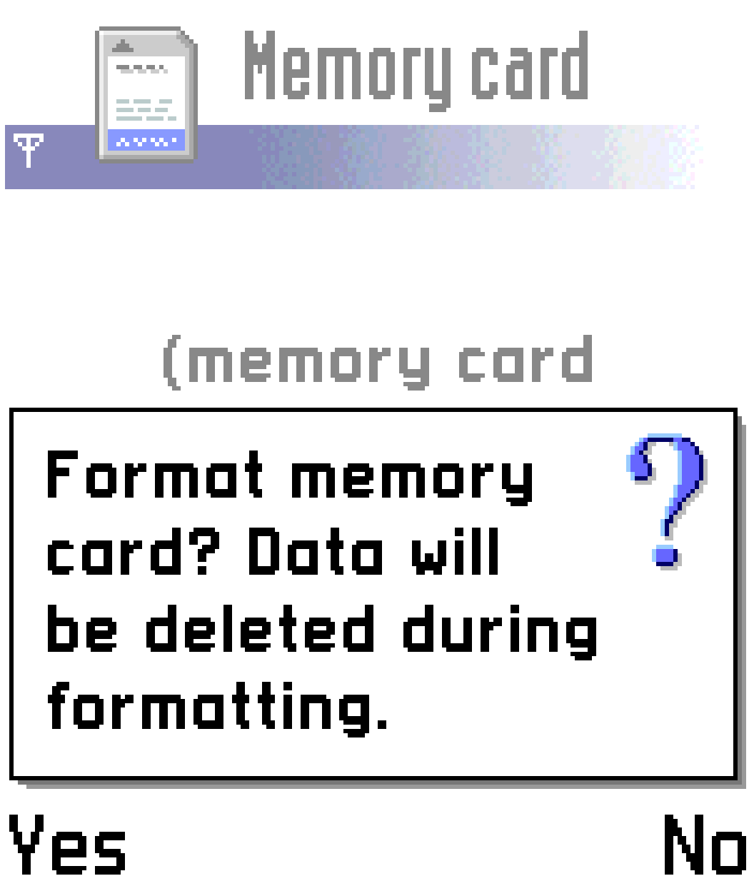
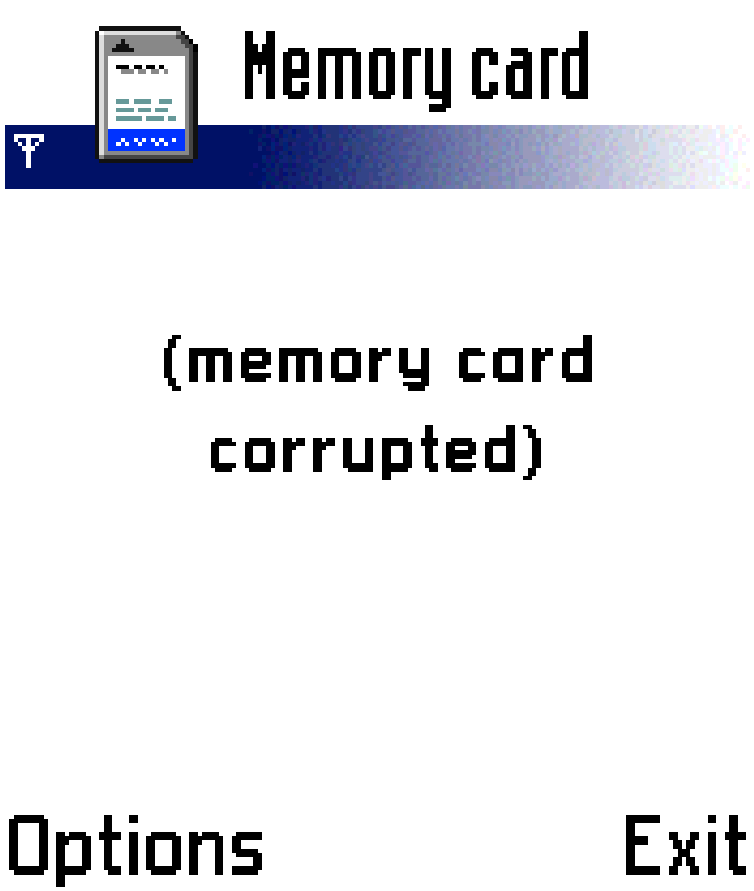

# SPMark04 MMC hardware result — 2026-11-14

**Stopped before application launch: Symbian reports the card corrupted.** No
benchmark scores or SPMark crash were obtained. Formatting was declined.

## Controlled test

- Original ngage1 build `2d9605f`, run43572455384/seed44, 78MHz.
- Original firmware/deadlines, initialized C: seed, auto-Run, Background save Off.
- Existing `/media/fat/games/ngage/spmark04.mmc`, mounted directly in slot2.
- No firmware/RAM patch, image conversion/replacement, Flush or formatting.
- RBF SHA256: `4a63d5c2eb3a91545c88ee96767ed3cde93b05b415164ad24988493b21905373`.

Stock Main MGL support supplies the selected card at core launch:

```xml
<mistergamedescription>
    <rbf>_Console/ngage1</rbf>
    <file delay="1" type="s" index="2" path="/media/fat/games/ngage/spmark04.mmc"/>
</mistergamedescription>
```

The launcher was written to MiSTer's `/tmp/ngage1-spmark04.mgl` and submitted
once through `/dev/MiSTer_cmd` as `load_core /tmp/ngage1-spmark04.mgl`.
Main's process is `MiSTer_Zaparoo`; its open descriptors verified the exact MMC
file plus `/media/fat/games/ngage1/boot0.vhd` and `boot1.vhd`. Linux opens images
read/write; the production MMC HDL adapter currently forces card read-only.

## Observations

1. Boot completed to native Phone/Menu. The usual eight Menu icons appeared;
   SPMark did not appear, including after an extended wait.
2. Tools → Memory displayed “Format memory card? Data will be deleted during
   formatting.” We selected **No**.
3. Memory then explicitly displayed **“(memorycard corrupted)”**.





The native result supersedes an earlier cardless “No memorycard inserted” test.
It demonstrates detection, not correct initialization/sector data. It does not
identify which MMC command, sector, filesystem invariant or driver expectation
failed. A benchmark crash cannot be inferred because the app never started.

## Image checks and limits

The existing inspector accepts the NGAGEMMC footer, supported MMC profile and
full payload extent: 16,773,632 bytes total, including a 512-byte footer;
32,760 payload sectors. CSD capacity equals payload length. Read-only host
directory parsing finds partition LBA32 and `SYSTEM/APPS/SPMARK/SPMARK.APP`
(UID3 `10200F51`), AIF/RSC, `3DTEST.DLL` and other assets. This was a directory
inspection, not an exhaustive FAT chain or original-phone compatibility check.

Before/after SHA256 values are identical:

| File | SHA256 |
| --- | --- |
| SPMark04 MMC | `60d7c4aa989b2393cbeb8f2bbd563cbce0bad5b33d8bb9dac28d89660a772919` |
| C: boot0.vhd | `4a75e4cb75d5fb25c4148f888e3e4858e37841f97834df7a002d6f38ca15b329` |
| PMM boot1.vhd | `71189f7fb6aed638640078fba3a35fda6c39c8962e74dcc75935aac948da9063` |

Reproducible launcher/inspection source, JSON manifests, captures and final
hashes remain in `scratch/spmark04-mmc-20261114/`. No production RTL changed.

## Follow-up

The active investigation now identifies and reproduces the CMD2 completion-order
failure before FAT reads. See [native R2 correction](mmc-r2-order.md). A new RBF
and successful original-firmware mount remain pending.

## Original next boundary

Trace original-driver MMC initialization and its first filesystem sector reads;
compare received bytes with the host image. Separate command/response/data-path
failure from filesystem expectations before changing the image or firmware.
Benchmark timing, IMEI queries and game execution are downstream, untested.

## Complete read-only allocation audit (build pending)

The exact card was audited while the user monitors build43603176364. FAT12,
partition type01/LBA32,32672sectors,8sectors/cluster, two12-sector FATs,512root
entries and4076data clusters. Both FAT copies match. All12files and318allocated
clusters are reachable through valid directory/file chains: no truncation,
loops, cross-links, orphan clusters, invalid links or partition/BPB bounds
violations were found. SPMark.APP is75676bytes in19clusters, SHA256
`f4d3819d0d7c21f6f669835d03cf9fd8c8b50aa3e0bac6975c4cbaccb09b3a4e`.

Image SHA remained60d7c4aa… before/after. This strengthens the evidence that
“corrupted” currently reflects identification/transport failure rather than
damaged FAT allocation; it does not prove original-firmware mount compatibility
or executable integrity. [Full audit](evidence/mmc-spmark04-fat-20261114.json);
read-only source in scratch/mmc-native-20261114/audit-fat.py.
