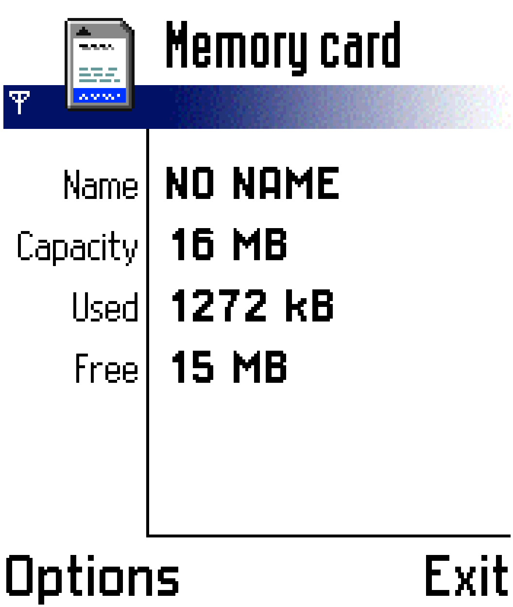
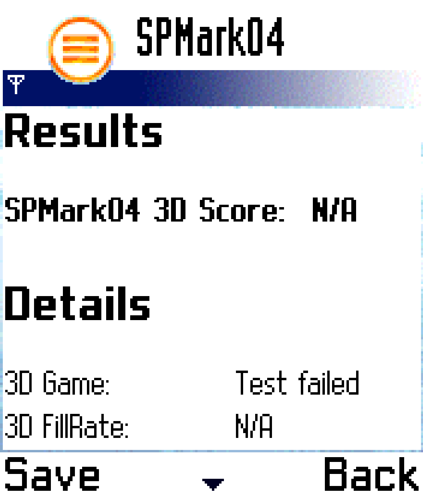
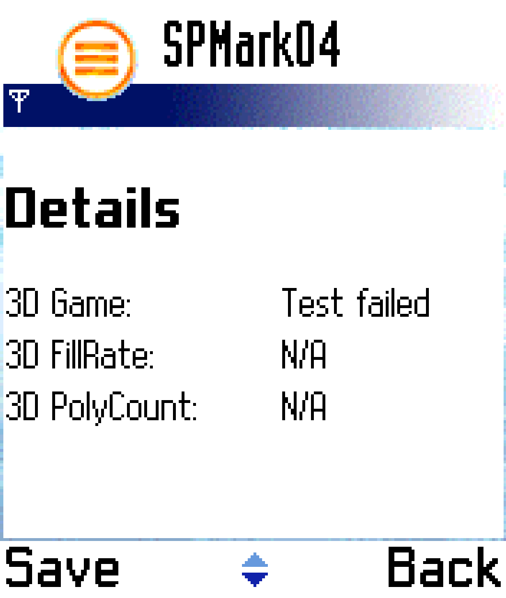
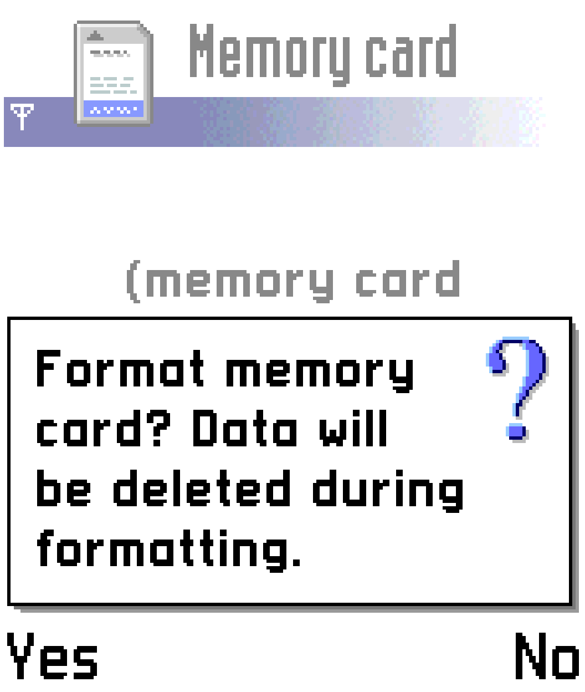
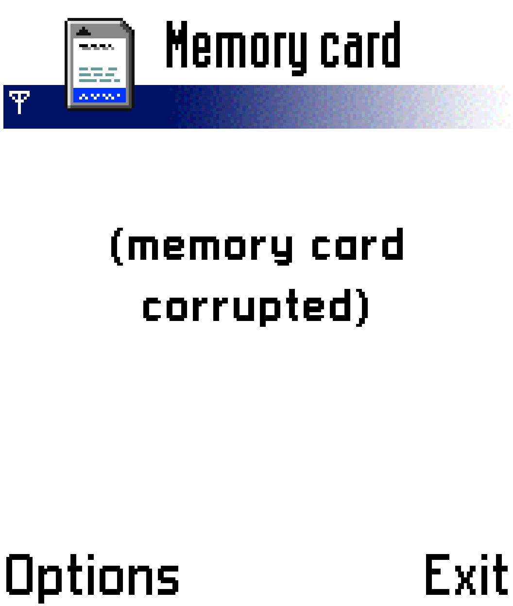

> Update: [completed native3D benchmark and all result rows](spmark04-benchmark.md). Same original card, Thumb LDM fix, delayed insertion; fit timing still fails.

> Follow-up: [native FillRate CPU cause and tested Thumb LDM correction](spmark04-benchmark.md). New RBF benchmark qualification is pending.

# SPMark04 MMC hardware result — 2026-11-14

**Current result: native read-only mount and SPMark04 launch work.** Original
firmware is unchanged. Run All Tests produces `3D Game: Test failed`, with
3D Score/FillRate/PolyCount all `N/A`. Options/results remain responsive; no
core reset or confirmed app crash was observed. The failure reason is unresolved.

The tested RBF is build43609237775/cd46abe/seed44, SHA256
`0a67b2b852f480496c588e42e5c6f0ca93c47ec0dffec1c75fca5f3b212fd85c`. It
fits37,983ALMs/508M10Ks but misses78MHz setup by0.270ns. These observations
are functional hardware evidence, not timing sign-off.

Native Memory reports NO NAME,16MB capacity,1272kB used,15MB free. Used bytes
match the318allocated4KiB FAT clusters. The same source MMC, C and PMM image
hashes and original ROM hash are verified unchanged after the benchmark. No
formatting, save/Flush, firmware patch or image replacement was used.







The two HDL corrections are [R2 completion ordering](mmc-r2-order.md) and
[native receive DMA control2](mmc-native-dma-control.md).
[Machine evidence](evidence/mmc-spmark04-board-20261114.json) records exact
identity, screens and bounded final diagnostics. The card remains mounted and
the phone is left on SPMark Results. Writable MMC and unrelated titles are
separate acceptance gates.

## Historical initial failure

The first test below stopped before launch and reported a corrupted card.
Formatting was declined. The current result above supersedes that stopping point.

## Initial controlled test

- Original ngage1 build `2d9605f`, run43572455384/seed44, 78MHz.
- Original firmware/deadlines, initialized C: seed, auto-Run, Background save Off.
- Existing `/media/fat/games/ngage/spmark04.mmc`, mounted directly in slot2.
- No firmware/RAM patch, image conversion/replacement, Flush or formatting.
- RBF SHA256: `4a63d5c2eb3a91545c88ee96767ed3cde93b05b415164ad24988493b21905373`.

Stock Main MGL support supplies the selected card at core launch:

```xml
<mistergamedescription>
    <rbf>_Console/ngage1</rbf>
    <file delay="1" type="s" index="2" path="/media/fat/games/ngage/spmark04.mmc"/>
</mistergamedescription>
```

The launcher was written to MiSTer's `/tmp/ngage1-spmark04.mgl` and submitted
once through `/dev/MiSTer_cmd` as `load_core /tmp/ngage1-spmark04.mgl`.
Main's process is `MiSTer_Zaparoo`; its open descriptors verified the exact MMC
file plus `/media/fat/games/ngage1/boot0.vhd` and `boot1.vhd`. Linux opens images
read/write; the production MMC HDL adapter currently forces card read-only.

## Initial observations

1. Boot completed to native Phone/Menu. The usual eight Menu icons appeared;
   SPMark did not appear, including after an extended wait.
2. Tools → Memory displayed “Format memory card? Data will be deleted during
   formatting.” We selected **No**.
3. Memory then explicitly displayed **“(memorycard corrupted)”**.





The native result supersedes an earlier cardless “No memorycard inserted” test.
It demonstrates detection, not correct initialization/sector data. It does not
identify which MMC command, sector, filesystem invariant or driver expectation
failed. A benchmark crash cannot be inferred because the app never started.

## Image checks and limits

The existing inspector accepts the NGAGEMMC footer, supported MMC profile and
full payload extent: 16,773,632 bytes total, including a 512-byte footer;
32,760 payload sectors. CSD capacity equals payload length. Read-only host
directory parsing finds partition LBA32 and `SYSTEM/APPS/SPMARK/SPMARK.APP`
(UID3 `10200F51`), AIF/RSC, `3DTEST.DLL` and other assets. This was a directory
inspection, not an exhaustive FAT chain or original-phone compatibility check.

Before/after SHA256 values are identical:

| File | SHA256 |
| --- | --- |
| SPMark04 MMC | `60d7c4aa989b2393cbeb8f2bbd563cbce0bad5b33d8bb9dac28d89660a772919` |
| C: boot0.vhd | `4a75e4cb75d5fb25c4148f888e3e4858e37841f97834df7a002d6f38ca15b329` |
| PMM boot1.vhd | `71189f7fb6aed638640078fba3a35fda6c39c8962e74dcc75935aac948da9063` |

Reproducible launcher/inspection source, JSON manifests, captures and final
hashes remain in `scratch/spmark04-mmc-20261114/`. No production RTL changed.

## Follow-up

The active investigation now identifies and reproduces the CMD2 completion-order
failure before FAT reads. See [native R2 correction](mmc-r2-order.md). A new RBF
and original-firmware mount were subsequently qualified above.

## Original next boundary

Trace original-driver MMC initialization and its first filesystem sector reads;
compare received bytes with the host image. Separate command/response/data-path
failure from filesystem expectations before changing the image or firmware.
Benchmark timing, IMEI queries and game execution are downstream, untested.

## Complete read-only allocation audit (build pending)

The exact card was audited while the user monitors build43603176364. FAT12,
partition type01/LBA32,32672sectors,8sectors/cluster, two12-sector FATs,512root
entries and4076data clusters. Both FAT copies match. All12files and318allocated
clusters are reachable through valid directory/file chains: no truncation,
loops, cross-links, orphan clusters, invalid links or partition/BPB bounds
violations were found. SPMark.APP is75676bytes in19clusters, SHA256
`f4d3819d0d7c21f6f669835d03cf9fd8c8b50aa3e0bac6975c4cbaccb09b3a4e`.

Image SHA remained60d7c4aa… before/after. This strengthens the evidence that
“corrupted” currently reflects identification/transport failure rather than
damaged FAT allocation; it does not prove original-firmware mount compatibility
or executable integrity. [Full audit](evidence/mmc-spmark04-fat-20261114.json);
read-only source in scratch/mmc-native-20261114/audit-fat.py.

## Offline SIS and reusable FAT12 media (2026-11-16)

The supplied `SPMark04_v1.10_business_S6.x_cracked-spaces.im.sis` is672632bytes,
SHA256 `36bb9f7dc511b1215380106e54b7d472e5bd0d1d553a7d493ab53c2965423393`.
Its14simple records contain12ordinary application/help files and2installer
text messages. All compressed streams finish cleanly and match declared lengths.
Text messages were preserved as data, not treated as instructions or run.

Generated images and reports are under `build/mmc/`; durable local input
folders are under `runtime/mmc/`. Reusable software is maintained in
[`tools/mmc-card/`](../tools/mmc-card/README.md).

| Image stem | Contents/source folder |
| --- | --- |
| `spmark-ready` |12extracted files in `extracted-files/`, original install destinations mapped to E: |
| `spmark-installer` |Unchanged SIS as `files/SPMARK.SIS`, visible at E:\SPMARK.SIS |
| `blank-fat12` |Empty filesystem, editable source folder `empty-files/` |

Each has a raw `.img` and core-ready `.mmc` with512byte NGAGEMMC footer.
All use32760payload sectors, partition LBA32/32672sectors, FAT12,8sectors per
cluster, two12sector FATs and512root entries. Ready/installer/blank free space
is15032/15644/16304KiB. Identities are synthetic folder-card identities, not a
claim of a physical original card. Current production HDL still forces read-only.

The frozen `mkcard.py`, `build-card.py`, `extract-spmark.py`, independent
`audit-fat.py`, provenance and `rebuild.command` live in `tools/mmc-card/`.
Add files under `runtime/mmc/files/` or `runtime/mmc/empty-files/` and run
`tools/mmc-card/rebuild.command` to regenerate all cards under `build/mmc/`.
The wrapper mounts the repository and uses the existing `jotego/simulator:arm64`
image. Its disposable mtools cache is `build/tools/mtools/`; the maintained
`setup.command` restores it after cleanup. Native Python/mtools can also run
`python3 tools/mmc-card/build-card.py SOURCE_FOLDER OUTPUT_STEM`.
Private runtime payloads are ignored by Git; `runtime/mmc/README.md` is maintained.

Every copied file was read back and compared. A separately implemented FAT
allocation audit passes all3cards with no errors or warnings; the maintained
MMC inspector validates footer/register CRCs/full CSD extent. The ready app's
hash equals the previously tested SPMark.app above. Moving and rebuilding the
cards retained all original image hashes. Reports are `build/mmc/*-fat-audit.json`
and `*-inspect.json`; extraction hashes are `runtime/mmc/extraction.json`.

The permanent long-filename, nested-directory and multi-cluster integration check
is `tests/tools/mmc_folder/check.py`; it passes with generated fixtures/images
under `build/mmc-tests/`, which are removed after use. Its summary remains in
`build/mmc-tests/result.json`. The original dated card experiment folder has been
removed from scratch. `AGENTS.md` explicitly requires scratch to stay disposable;
reusable software, permanent tests and useful runtime data belong elsewhere.

These newly generated images have not been booted or installed on hardware.
The ready image copies files without generating installer registration records.
Normal installation from the SIS card is a separate pending check; with current
read-only MMC, it would need internal C: if offered by the native installer.
Established app discovery requires the card mounted before a fresh phone boot;
runtime replacement remains unreliable. No phone session/media/save state, HDL,
firmware, build/CI or other simulation was changed during this preparation.

## Native C: SIS installation (2026-11-16)

Original installer-only MMC is recognized by **Tools→Manager**. Extras→Apps is
the Java manager. The original SIS completes installation on C:; all12 payload
hashes match the original in a private original-filesystem verification. The
phone subsequently stalls during C: garbage collection, with217 unsaved sectors.
A confirmed CPU/NOR/refill circular wait is fixed inec6ef3c; hardware qualification
is pending. This is separate from MMC FAT/mount correctness. Keep native JPEG
unqualified until it is actually run from C: on the fixed build.
[Installation, save and regression evidence](installation-flash-stall.md).
