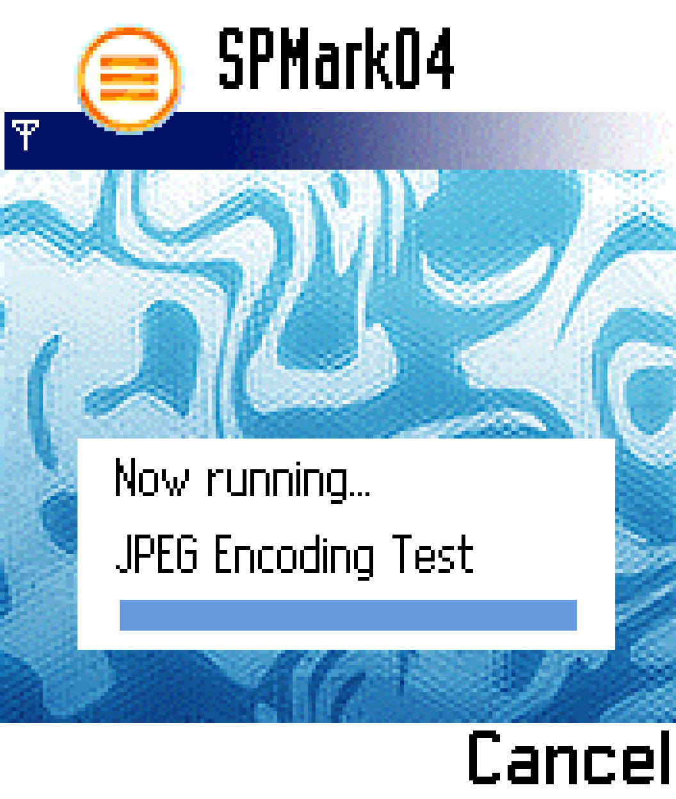

# SPMark04 JPEG encoding wait — 2026-11-15

## Hardware-confirmed cause

The user authorized a fresh traced repeat. **The JPEG test waits forever after
its input image decodes successfully beyond SPMark's10-second deadline.** The
actual compression loop has not started. No changed deadline, result or
functional firmware substitution was used.

| Event | Time after timer request | Native observation |
| --- | ---: | --- |
| Arm input open/decode timer |0s |10,000,000microseconds, callerFFF02CAC |
| Timer RunL dispatch |11.4371s |CActive::Cancel with iActive0, callerFFF02C00 |
| RunL closes timer |11.4376s |Close callerFFF02C08; no Scheduler::Stop |
| Successful decode callback |11.9841s |Cancel with iActive0, success-path callerFFF02FF4 |

No JPEG-encoder timer (FFF02DA8) is reached. There is no Scheduler::Stop after
this callback for at least14.86seconds within the same complete capture. The
same observer records60normal stops during the preceding image/scaling work.
The accepted180-second capture has247JPEG-helper events, zero reader gaps or
producer drops, generation0, unchanged13bus errors, no sticky first fault or
recorded panic, and save Off. Follow-up monitoring retains the wait.
[Exact ordering](evidence/spmark-jpeg-confirmed-ordering-20261115.json).

This confirms the original application's timeout/recovery defect under this
measured workload. It is **not a stuck JPEG instruction, missing successful
codec callback, or a new persistent bus stall** in this reproduction. It does
not prove all CPU/peripheral behavior correct or attribute decode cost to a
particular RTL block. The timer is dispatched late rather than before its
requested10seconds; slowing the phone's timers would change phone behavior.

The under10-second requirement needs about20%greater end-to-end throughput
relative to this11.984-second instrumented request, plus operating margin.
That request includes input loading, decoder/server scheduling and observer
cost; it is not a standalone JPEG throughput measurement. The follow-up
[profile and original-code benchmark](spmark-jpeg-profile.md) identifies bitmap
conversion/error diffusion as the leading sampled cost and validates a Thumb
workload for CPU/cache completion work. Existing six-kernel SPMark tests do not
cover JPEG. Compression performance/results remain unqualified.

Optimization work is paused for this blocking investigation. The user runs the
system tests and retains hardware/input control. The installed RBF file hash,
open SPMark MMC and raw capture summaries are in the [hardware evidence](evidence/spmark-jpeg-monitor-20261115.json).
Initial monitoring used no keys, reload, save or patch. The later authorized
repeat reloaded the same RBF with the same SPMark MMC and added only the observer. The user reports the latest clock-enabled build still requested
the date; that is recorded separately in TODO.md. Build-date telemetry alone
does not identify an exact source commit.

## Observed on hardware

Image rendering and scaling progress. JPEG input decode executes original
MediaServerJpeg code, then the screen remains on JPEG Encoding Test with an
empty progress bar. Subsequent samples mostly show scheduler and background
code, not a single JPEG arithmetic loop or persistent memory-bus wait.
Captures02/03 retain generation1, bus-error count25, no sticky first fault,
no recorded panic, no save-queue fault and Background save Off. The initial
capture was generation0 before the user's test boot; this is not evidence that
JPEG itself reset the phone. Counters wrap and screenshots/text are sampled.
A later screenshot shows the clock screensaver without agent input; this does
not establish SPMark completion or exit.
The existing DDR monitor cannot identify every thread's wait object or recover
its full SDRAM register/stack state.

An older2026-11-14 run already exhibited this JPEG wait, as recorded in
[the earlier benchmark](spmark04-benchmark.md). The newest CPU changes are not
established as its origin.

## Original-code timeout candidate

The original SPMark app's JPEG driver is10004c3c at its preferred base
(runtime app previously identified atfff00000). It first opens `test.jpg`
relative to its application path. JPEG **output goes to a128KiB memory
descriptor**, via CMdaImageBitmapToDescUtility::CreateL; this is not a JPEG
output-file write to C: or the read-only MMC. A stable read-only C: capture was
obtained before this distinction was established; no disk extraction or repair
is justified by the output-file hypothesis.

The first/last sampled JPEG-library PCs span11seconds, compatible with exceeding
the app's10second deadline; these samples do not establish timer/callback order
or continuous JPEG execution.

The app arms an RTimer for10,000,000microseconds before starting the nested
active scheduler. Its active-object vtable maps DoCancel to10002c10 and RunL
to10002bf4. DoCancel cancels/closes the timer and calls Scheduler::Stop. RunL
calls CActive::Cancel, then closes the handle; after normal scheduler dispatch
has cleared iActive, Cancel skips DoCancel. A later ConvertComplete10002fcc
also calls Cancel on the inactive object and cannot stop that scheduler.

Eight local cases execute original app RunL/ConvertComplete and original
EUSER CActive::Cancel50399b90. Callback before expiry invokes Stop once;
modeled timeout dispatch before callback invokes it zero times, for results
0/-1/-4/-33. Callee-saved registers, stack and stored result are checked.
RTimer Cancel/Close, Stop and WaitForRequest are spies; the dispatch inactive
state is modeled. This proves that code path under the stated ordering,
**not that the board took it or that HDL is faulty**.
[Original-code results](evidence/spmark-jpeg-timeout-reproduction-20261115.json).
An initial fixture incorrectly treated caller-saved r12 as callee-saved;
corrected ABI checks pass. No production RTL was changed.

## Prepared hardware discriminator

A narrow observer filters only SPMark JPEG call sites at native RTimer::After,
CActive::Cancel, RHandleBase::Close and CActiveScheduler::Stop. It records timer
interval, object, active flag/handle and caller. A RunL-origin Close followed
by ConvertComplete Cancel with iActive0 and no Stop would distinguish the
candidate from a missing completion or active CPU loop.

216exact GPR/CPSR/SP/LR/live-stack/object/log/filter/displaced-instruction cases
pass; RDebug's ABI is spied, not its full firmware service.223guarded writes
retain checksum validation, with no modified deadlines/results. It requires
a fresh held boot and is removed by reload. Applied after user approval, fresh-Hold preflight and full223-word/image
verification. It captured the ordering above. A stock reload then removed it; the complete original-ROM hash, same RBF/MMC
and saved RunOn/saveOff are [verified](evidence/spmark-jpeg-restored-stock-20261115.json).
Post-reload CPU clocks advance with generation0 and no sticky fault; the final
screenshot shows responsive Phone home. Hardware control is returned to the user. No new RBF build
is needed. See [observer manifest](evidence/spmark-jpeg-observer-manifest-20261115.json)
and [observer tests](evidence/spmark-jpeg-observer-test-result-20261115.json).

Sources, exact images and raw logs stay under
`scratch/spmark-jpeg-debug-20261115/`. Original firmware/game bytes are local only.

Reproducer sources are retained explicitly under that scratch directory:
`build-observer.py`, `test-observer.py`, `test-timeout.py` and `parse-events.py`.
The builder uses the original local ROM/service files and cached extracted
SPMark app; it prepares the guarded remote script but never connects/applies it.
Unicorn tests require native JIT execution outside the macOS sandbox. Do not
reuse the transient applied image as production firmware.

## New RBF boot regression — 2026-11-15

The50114ac/seed43 RBF cannot yet qualify JPEG. Direct automatic starts reach
kernel startup and eventually PLAT0x1005B with `Notifer Secnot.dll failed to
load`; fresh held starts reproducibly reach the low abort loop0000060C with
FAR8AFFFxxx. A delayed MGL card launch fails before its card insertion, and a
direct held/cardless start also fails. No MMC-format or card-image fix follows
from these observations.

The previous d4f2a8/seed44 image, staged in Linux RAM, passes automatic AND
fresh held starts using the same C/PMM files and original firmware. ADSP42OK
and the time/date prompt return. The installed SD RBF remains the newer image.
Both firmware/control images use identical SDRAM source, but their fitter reports
have materially different DQ placement:

| Check | Previous working placement | New failing placement |
| --- | ---: | ---: |
| Input I/O registers |16/16|16/16|
| Output I/O registers |16/16|0/16|
| Output-enable I/O registers |16/16|16/16|
| Clear/load output packing warnings |0|16|

This is a concrete physical implementation regression and resembles the earlier
[SDRAM investigation](sdram-early-boot-2026-11-13.md). It does not isolate all
CPU changes or prove that poor pin packing causes every new failure. The new
placement additionally misses78MHz setup on39reported paths (worst-0.586ns),
including completion-to-cache-0.279ns; these remain separate qualification risks.
The two board images also use different seeds. No F2 rollback was made.

The narrow candidate preserves the existing dq_pad registers and disables
synchronous control extraction for that vector only, keeping its data mux onD.
The supported setting is described in the
[Quartus Standard reference](https://docs.altera.com/r/docs/d815780/17.1/quartus-prime-standard-edition-settings-file-reference-manual/allow_synch_ctrl_usage?contentId=AMBYKRhHZgZlN3Ka97rkXg).
No registers, request stages, timing exceptions or changed PLL are introduced.
A new fit must prove the attribute achieves16/16output packing; simulation
cannot establish this. The CI action now runs the existing pin-register checker
as a distinct gate while preserving RBFs/reports after failed qualification.

Four-state Micron tests pass all16full/production combinations at78/104MHz
and modeled clock-pin delays0/.25/.5/1ns. Their deliberately wrong capture-edge
case still fails. The report checker accepts the old actual report and rejects
the new actual report. These establish model behavior/checker sensitivity,
not a successful new fit or a passed native JPEG deadline. The716-word startup
exit observer was applied only in verified fresh Hold and failed before its
hooks; the subsequent stock-old reload removed it. No functional firmware
patch, deadline change, disk write or save was used.

Raw captures/reports/source/artifacts: `scratch/jpeg-f2-board-20261115/`.
[Compact evidence](evidence/jpeg-f2-board-20261115.json).

For future controlled card insertion, installed MiSTer_Zaparoo accepts one
newline-terminated `/dev/MiSTer_cmd` command:
`zaparoo_mount 3 /media/fat/games/NGage/spmark04.mmc`.
The argument3 is the one-based declaration order of the three mountable slots,
so it selects raw HPS slot2. It does not reload the core; the file-open control
was verified. This is not proof native NEM-4 firmware supports runtime hot swap.
MGL delay is measured in seconds, not milliseconds. Use the cached hardware
control skill for ordinary inputs; do not rediscover the API or rely on screen
captures to inspect OSD focus.

## Native C: repeat — 2026-11-16

With11612f9/run43806580928/seed44/debugOn, C: housekeeping and Background save
now complete: stable live/file bytes match. SPMark launches from C: while the
cold-mounted MMC contains only the installer. Native custom selection deselects
all7other items and retains JPEG. It reaches JPEG Encoding Test and remains
waiting after more than60s. Generation0,13unchanged bus errors, no sticky first
fault/panic/queue fault; normal background code and ACKs continue. This isolates
JPEG from Calendar and writable-installation problems. Exact timer/callback
ordering was not retraced in this repeat; the earlier observer evidence remains
the established mechanism, not a newly observed timing measurement.

Current RBF misses setup0.832ns despite correct pin packing, so physical timing
remains a separate qualification limit. The corrected block-transfer candidate
passes simulation gates and improves the measured converter3.78% relative to
this CPU, but has not yet been tested natively. No deadline or firmware patch.
Captures: build/diagnostics/spmark-c-install-20261116/native-C-jpeg-only.jsonl;
screens: build/sim/screens/spmark-C-{custom-last,jpeg-start,jpeg-after}-20261116.png.

## Corrected CPU native C: repeat

00fbbea/run43811564130/seed43 boots cardless to Phone with original firmware,
no tracer applied, normal saveOn and healthy queue. Native custom selection
explicitly retains JPEG and deselects all7other items. JPEG remains waiting
through95s; no completion/result is claimed. Exact timer/callback ordering has
not yet been recaptured on this faster CPU, so distinguish the established
older input-decode timeout from this newer visual wait. An encoder timeout is
not excluded solely by the unchanged screen. Next metadata build and/or the
already tested observation-only timeline will distinguish the remaining cost.
